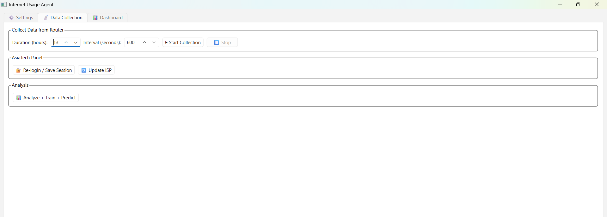
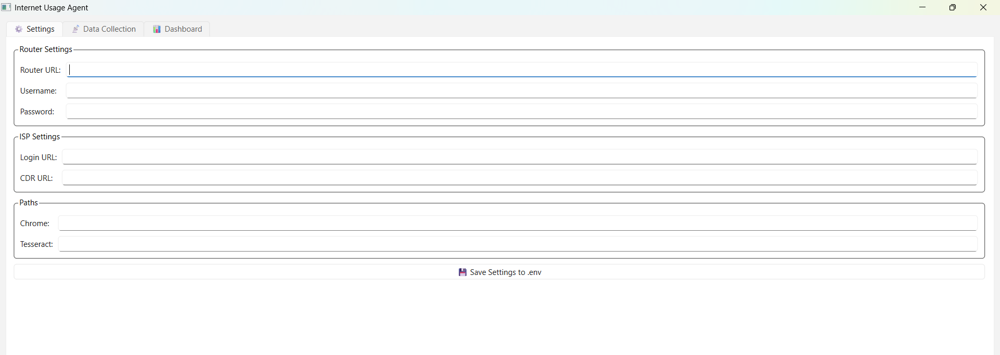
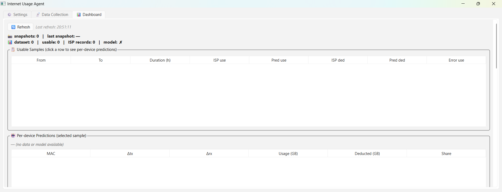

# NetScope

> Estimate per-device internet usage on older home routers using
> router traffic data and ISP usage records.

[](https://www.python.org/)
[](https://doc.qt.io/qtforpython/)
[](https://creativecommons.org/licenses/by-nc/4.0/)
[]()

---

## 📖 What is this?

Many older home routers can show *which* devices are connected, but
they don't provide **per-device traffic statistics**. At the same
time, your ISP's usage panel may show the **total** amount of data
consumed — without identifying *which device* generated it.

So a simple question goes unanswered:

**"Which device on my network is actually using all the bandwidth?"**

Your ISP shows the total — but not *who* consumed it.
Your router shows connected devices — but not *how much* they used.

NetScope is a desktop application that attempts to bridge this gap
by combining both sources into an **estimate** of per-device usage.

### 💡 Who is this for?

If you have an **older home router** without per-device traffic
reporting, and you want a rough idea of how much each user on your
network is consuming, NetScope may help — without you having to
spend money on a new router just to get that feature.

NetScope runs on your own PC, uses your existing router's client
page plus your ISP's usage report, and produces an approximate
per-device breakdown.

### How it works

1. Capture router client-page screenshots
2. Extract packet counters using OCR
3. Collect ISP usage records (CDR report)
4. Correlate router and ISP data by time window
5. Estimate total usage using a statistical model
6. Allocate the estimated usage across devices
7. Visualize the results in a desktop dashboard

---

## ⚠️ Project Status

> **This project is still under active development.**
> It is **not** a finished product and should be treated as a
> **work-in-progress tool**.

What that means in practice:

- Predictions are **approximate estimates**, not exact measurements.
  The model estimates the **total** ISP usage for each time window
  and then **allocates** that estimate across devices based on their
  observed packet contribution — it does **not** directly observe
  true per-device ISP traffic.
- Estimates **may become more stable** as more representative data
  is collected over time, but this is not guaranteed — noisy inputs
  or changing usage patterns can still degrade accuracy.
- Some features may change, break, or be reworked between versions.
- The router-screenshot + OCR pipeline is sensitive to router UI
  layout changes and screen resolution.
- Do not rely on this tool for billing disputes, legal matters, or
  anything where exactness is required.

If you're comfortable with that and want a rough picture of your
network usage — you're in the right place.

---

## 🏗 Architecture

```
             ┌──────────────┐
             │ Home Router  │
             └──────┬───────┘
                    │
                 Screenshots
                    │
                  OCR (Tesseract)
                    │
                    ▼
              Router Snapshots
                    │
                    │
                    ▼
               Correlation  ◄─────────── ISP CDR Records
                    ▲                          ▲
                    │                          │
                    │                       Scraping
                    │                          │
                    │                  ┌───────┴───────┐
                    │                  │  ISP Panel    │
                    │                  └───────────────┘
                    │
             ┌──────┴───────┐
             │     Model    │
             │ Ratio / OLS  │
             └──────┬───────┘
                    │
                    ▼
           Per-device Estimates
                    │
                    ▼
                Dashboard
```

**In short:** two independent data sources (router + ISP) are
collected over time, aligned by time window, and fed into a small
statistical model that produces per-device estimates.

---

## ✨ Features

- 📸 **Automated router collection** via Playwright + Tesseract OCR
- 🌐 **ISP CDR scraping** with session persistence
- 🧠 **Per-device usage prediction** (ratio baseline + linear regression)
- 📊 **Live dashboard** with tables and charts (PyQtGraph)
- 🔐 **Session-based login** for the ISP panel
- 💾 **Append-only snapshot storage** (crash-safe JSONL)

---

## 📸 Screenshots

### Dashboard


### Collection


### Settings


---

## 📊 Sample Output

After collecting data over several days, the dashboard produces a
per-device breakdown like this.

> **These values are model estimates, not directly measured
> per-device ISP traffic.** The model estimates the total for each
> time window, then allocates it across devices based on their
> packet share.
>
> The table below comes from **only a few days of data and a handful
> of MAC addresses**. It is meant as an illustration, not a
> benchmark.
>
> **Tip:** For this prototype, collecting **at least a week** of
> data is recommended. Longer collection periods may provide more
> representative training data, especially for the linear model.

```
MAC                      09-24     09-25     09-26     09-27     09-28     09-29     09-30      TOTAL   Share
-------------------------------------------------------------------------------------------------------------
AA:BB:CC:11:22:33        0.142     7.095     7.949    11.885    16.245    24.524    26.953     26.953   43.2%
DE:AD:BE:EF:00:01        1.025     4.257     7.133     8.485    11.407    14.540    15.969     15.969   25.6%
FE:DC:BA:98:76:54        0.441     4.767     6.060     6.991    10.558    12.644    14.168     14.168   22.7%
00:11:22:33:44:55        0.009     0.663     0.911     0.911     1.453     3.047     3.318      3.318    5.3%
12:34:56:78:9A:BC        0.289     0.817     0.986     0.986     1.296     1.663     1.663      1.663    2.7%
-------------------------------------------------------------------------------------------------------------
Total                    3.852    18.331    23.339    28.899    40.248    56.798    62.328     62.328    100%
```

*All MAC addresses in this example are fictional.*

**Notes on this table:**

- Values are in **GB per day**, one column per day.
- The `TOTAL` column sums the window; `Share` is that device's
  fraction of the grand total.
- The numbers come from a **small sample** of days and devices.
  With only a few days, per-device estimates can swing noticeably
  day-to-day.
- Devices that were offline on a given day show very small or zero
  values — that's expected, not a bug.

---

## 🛠 Requirements

- **Python** 3.10 or newer
- **Google Chrome** (for Playwright automation)
- **Tesseract OCR** ([download for Windows](https://github.com/UB-Mannheim/tesseract/wiki))
- **Windows** (tested) — Linux/macOS may work but are not tested

---

## 🚀 Installation

### 1. Clone the repository

```bash
git clone https://github.com/msolniku/netscope.git
cd netscope
```

### 2. Create a virtual environment

```bash
python -m venv ENV
ENV\Scripts\activate
```

### 3. Install dependencies

```bash
pip install -r requirements.txt
```

### 4. Configure your environment

Copy `.env.example` to `.env` and fill in your values:

```bash
copy .env.example .env
notepad .env
```

Required variables:
- `ROUTER_URL` — your router's client list page
- `ROUTER_USERNAME` / `ROUTER_PASSWORD` — router credentials
- `ISP_LOGIN_URL` / `ISP_CDR_URL` — your ISP's panel URLs
- `CHROME_PATH` — path to chrome.exe
- `TESSERACT_CMD` — path to tesseract.exe

### 5. Run the app

```bash
python run_gui.py
```

---

## 📚 How to Use

1. **Settings tab** → enter your router and ISP credentials, save
2. **Collection tab** → click *"Login / Save Session"* for your ISP
3. **Collection tab** → click *"Start Collection"* — the app will
   screenshot your router every N seconds and OCR the results
4. **Collection tab** → click *"Update ISP"* to scrape the CDR report
5. **Collection tab** → click *"Analyze + Train + Predict"* to build
   the dataset, train the model, and generate predictions
6. **Dashboard tab** → explore results

> **Reminder:** The estimates depend heavily on how much data you
> collect. With only a day or two, expect rough numbers; a longer
> collection period usually produces more representative results.

---

## 🧠 ML Module

The `ml/` package contains everything related to learning and
prediction. It is deliberately split into three small scripts so
each one has a single, testable job.

```
ml/
├── train.py      # Fit usage + deducted models, compute metrics, save model.json
├── scoring.py    # Pure prediction functions (no I/O, no side effects)
└── predict.py    # CLI reporter — loads model.json and prints per-sample predictions
```

### 1. Feature & target definition

Each dataset sample is one ISP billing window. The model learns the
mapping from **router packet counters** to **ISP-reported GB**:

| Type     | Name              | Source                       |
|----------|-------------------|------------------------------|
| Feature  | `delta_tx`        | Router snapshot (packets)    |
| Feature  | `delta_rx`        | Router snapshot (packets)    |
| Feature  | `duration_hours`  | ISP window length            |
| Target A | `isp_usage_gb`    | ISP CDR report               |
| Target B | `isp_deducted_gb` | ISP CDR report (may be null) |

The exact form is:

```
usage_gb ≈ w_tx · Δtx + w_rx · Δrx + w_dur · duration_hours + bias
```

### 2. Two independent models

`train.py` fits **two separate models** — one for `usage_gb` and one
for `deducted_gb` — instead of sharing weights. This matters because:

- Older records may have a usage value but **no** deducted value
- ISPs sometimes apply bonuses / off-peak rules that make the two
  numbers diverge

If **no sample at all** has a `deducted_gb` value, the trainer falls
back to duplicating the usage model for deducted predictions and
marks it in the saved file:

```json
"deducted": { "...": "...", "note": "fallback: no deducted_gb samples were available" }
```

### 3. Ratio baseline vs. linear fit

A naive `lstsq` with 4 free parameters will happily overfit when
there are only 5–6 samples — the in-sample R² looks almost perfect
while real error is huge. So the trainer uses a **two-stage rule**:

| Usable samples | Method chosen                        |
|----------------|--------------------------------------|
| `< 8`          | Ratio baseline (one weight, no bias) |
| `≥ 8`          | Full linear OLS with intercept       |

Constants live at the top of `train.py`:

```python
MIN_SAMPLES_FOR_LINEAR = 8
MIN_SAMPLES_FOR_CV     = 5
```

The ratio baseline assumes every packet costs the same and duration
has no weight. It's crude but very hard to overfit.

### 4. Honest evaluation: Leave-One-Out CV

In-sample metrics (MAE / RMSE / R² computed on the same data used
for fitting) are optimistic. The trainer therefore also runs
**leave-one-out cross-validation** once there are at least 5 usable
samples:

- For each sample `i`, refit on all the *other* samples
- Predict sample `i` with the held-out model
- Report MAE / RMSE / R² across all held-out predictions

Both sets of metrics are saved into `model.json`:

```json
"metrics":    { "mae_gb": 0.42, "rmse_gb": 0.61, "r2": 0.94 },
"cv_metrics": { "mae_gb": 0.88, "rmse_gb": 1.12, "r2": 0.81, "n_folds": 12 }
```

The CV number is the one you should trust when deciding whether the
model is actually useful yet.

### 5. Per-device prediction

`scoring.py` contains only pure functions — no file I/O, no side
effects. The main flow is:

1. Compute each device's **packet share**:
   `share = (Δtx_dev + Δrx_dev) / (Δtx_total + Δrx_total)`
2. Predict raw device GB:
   ```
   raw = w_tx·Δtx_dev + w_rx·Δrx_dev + (w_dur·dur + bias)·share
   ```
   Notice that the duration and bias terms are split **by share**,
   not duplicated per device.
3. **Clip** negative values to `0` (can happen when `bias < 0`).
4. **Renormalize** so per-device values sum back exactly to
   `predict_sample_total()`. This preserves the invariant that
   device shares always add up to the window total, instead of
   silently losing GB to clipping.

**Important architectural note:**

> The model does **not** directly observe the true per-device ISP
> usage. It estimates the **total** ISP usage for each time window
> and **allocates** that estimated total across devices according to
> their observed packet contribution. Per-device numbers are
> therefore **model estimates**, not ground truth.

### 6. Model file format

`data/model.json`:

```json
{
  "features":    ["delta_tx", "delta_rx", "duration_hours"],
  "target_unit": "GB per window",
  "usage": {
    "w_tx": 1.2e-8, "w_rx": 1.1e-8, "w_dur": 0.0, "bias": 0.0,
    "method": "ratio",
    "n_samples": 6,
    "trained_at": "2026-10-03T12:00:00",
    "metrics":    { "...": "..." },
    "cv_metrics": null
  },
  "deducted": { "...": "..." },
  "trained_at": "2026-10-03T12:00:00"
}
```

### 7. Running the ML pipeline

```bash
# Fit both models and save data/model.json
python -m ml.train

# Print per-sample, per-device predictions using the saved model
python -m ml.predict
```

`ml.predict` refuses to run if `model.json` is missing and tells
you to run `ml.train` first.

---

## ⚠️ Disclaimer

This project is intended for **educational and personal use only**.

Scraping or automating access to an ISP's customer panel may
violate their Terms of Service. **You are solely responsible for
how you use this tool** and for complying with your ISP's rules
and local laws.

The author assumes no liability for any misuse or legal
consequences arising from this software.

NetScope provides **approximate estimates**. Do not use it as the
sole basis for billing decisions, network policy enforcement, or
anything requiring exact traffic accounting.

---

## 📄 License

Licensed under the
[Creative Commons Attribution-NonCommercial 4.0 International License](https://creativecommons.org/licenses/by-nc/4.0/).

You may use, modify, and share this project **for non-commercial
purposes only**, as long as you credit **msolniku**.

---

## 🙏 Acknowledgements

- [PySide6](https://doc.qt.io/qtforpython/) — Qt for Python
- [Playwright](https://playwright.dev/python/) — browser automation
- [Tesseract](https://github.com/tesseract-ocr/tesseract) — OCR engine
- [PyQtGraph](https://www.pyqtgraph.org/) — fast plotting
- [jdatetime](https://github.com/slashmili/python-jalali) — Jalali dates